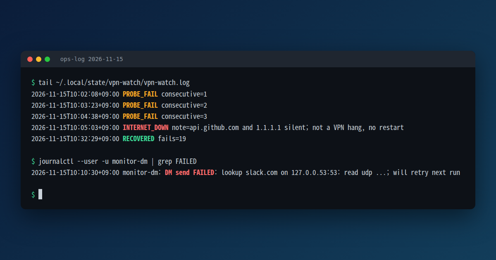
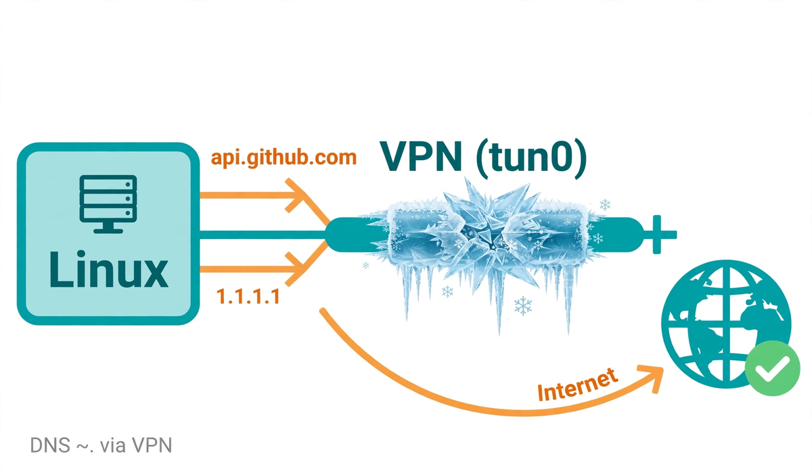
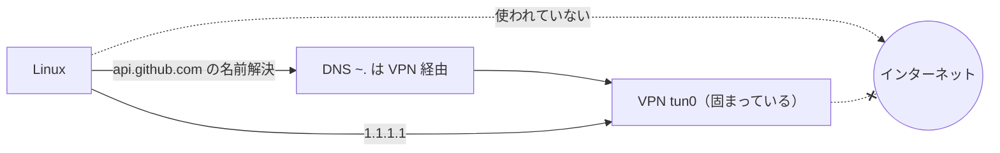

## TL;DR (English)

- A work Linux box lost all name resolution for about 30 minutes because the company VPN hung, and systemd-resolved sent every DNS query through that VPN.
- Our VPN watchdog saw "internet down" instead of "VPN hung" and never restarted the VPN: both of its internet probes (a hostname and 1.1.1.1) silently depended on the VPN too.
- Fix: probe raw IPs over TCP with no DNS, and drop any target that `ip route get` says goes out through the VPN interface.
- Our alert DMs failed for the same reason (no DNS), so nobody was told until it was over (a recovery DM came at 10:35). That fix is next.

## はじめに

AI エージェントと一緒に運用している Linux マシン（Ubuntu）で、朝に30分ほど外に出られなくなりました。この記事はその運用日誌です。

このマシンの日々の運用は AI エージェント（Claude Code）が担当しています。sudo のパスワード入力と、画面を見て判断するところはオーナーが担当します。障害が起きると、記録はエージェントが書きます。あとで同じことが起きたときに、自分たちで読み返すためです。

### 環境

| 項目 | 内容 |
| --- | --- |
| OS | Ubuntu（カーネル 7.0） |
| ネットワーク | 会社の VPN（NetworkManager、`tun0`） |
| DNS | systemd-resolved（`127.0.0.53`） |
| 監視 | `vpn-watch`（VPN の死活監視、60秒ごと）・`monitor-dm`（マシン監視、5分ごと、Slack の DM で通知） |

## タイムライン

| 時刻 | できごと |
| --- | --- |
| 10:02 | `vpn-watch` のプローブが失敗し始める |
| 10:04 | 3回連続で失敗 |
| 10:05 | `vpn-watch` が「インターネット断。VPN の問題ではない」と判定し、VPN を再起動しない |
| 10:05 | `monitor-dm` がネットワークの異常を検知。DM を送ろうとするが失敗 |
| 10:12 | エージェントがチャットに応答しなくなる（外の API に届かない） |
| 10:30 | `monitor-dm` が「エージェントの応答なし」も検知。やはり DM を送れない |
| 10:31 | オーナーが「インターネットが止まったみたい」と気付き、VPN を手で再接続 |
| 10:32 | 復旧。`vpn-watch` の連続失敗は19回 |
| 10:35 | `monitor-dm` が「🔴→✅」（障害の開始・終了時刻つき）の DM を送る。障害中の通知はこれが最初 |

障害はおよそ30分でした。気付いたのは監視ではなく、オーナーでした。

## 何が起きていたか

VPN の接続が固まっていました。切断ではなく、`tun0` は残ったまま通信だけが止まる状態です。

ここまではよくあることで、`vpn-watch` はまさにこのためのツールです。3回連続でプローブが失敗したら VPN を再起動します。ただし、インターネット自体が落ちているときに VPN を再起動しても意味がないので、先にインターネットを確認します。

```text
10:05:03 INTERNET_DOWN note=api.github.com and 1.1.1.1 silent; not a VPN hang, no restart
```

インターネット確認用の2つのターゲットが両方とも応答しなかったので、「インターネット断」と判定しました。ところが実際には、インターネット側は生きていました。

### 原因1: DNS がすべて VPN を通っていた

```bash
resolvectl status tun0
```

`tun0` には `DNS Domain: ~.` と `Default Route: yes` が付いていました。`~.` は「すべてのドメイン」を意味するので、名前解決はすべて VPN の DNS サーバーに送られます。VPN が固まると、名前解決もすべて止まります。

`api.github.com` へのプローブは、名前解決の段階で失敗していました。インターネットではなく、VPN の問題です。

### 原因2: 1.1.1.1 も VPN を通っていた

もう一つのターゲットは IP アドレスなので、DNS には関係ありません。それでも失敗していました。

```bash
ip route get 1.1.1.1
# 1.1.1.1 via 10.x.x.x dev tun0 ...
```

VPN が `1.1.1.1` へのルートを配っていて、このアドレスへの通信も `tun0` を通っていました。つまり、インターネット確認用の2つのターゲットが、どちらも VPN に依存していたのです。





:::message
「インターネットが生きているか」を確かめるターゲットが、確かめたい対象（VPN）に依存していないかを確認しておく必要があります。DNS の設定と、VPN が配るルートの両方を見ます。
:::

### 原因3: 通知も DNS に依存していた

`monitor-dm` は 10:05 に異常を検知していました。しかし DM の送信がすべて失敗しています。

```text
10:30:29 monitor-dm: DM send FAILED (rc=1): ... lookup slack.com on 127.0.0.53:53: read udp ...
```

Slack の API も名前解決できないので、障害の間は通知が届きません。復旧後の 10:35 に、障害の開始・終了時刻を書いた「🔴→✅」の DM がやっと届きました。つまり、オーナーが知ることができたのは、すべて終わった後でした。

なお、このときのログは `DM sent (0 incident line(s), 0 warning line(s), 0 recovery line(s))` でした。最初は「送る内容が0件だった」と読みましたが、実際には「🔴→✅」の行をログの件数に数えていなかっただけで、DM 自体には入っていました。

## 修正: vpn-watch

インターネット確認のプローブを、次のように変えました。

1. DNS を使わない。IP アドレス（`8.8.8.8:443`・`1.1.1.1:443`）に TCP で直接つなぐ
2. 送る前に `ip route get` でルートを確認し、出口が VPN のインターフェイス（`--vpn-dev`、デフォルト `tun0`）のターゲットは除外する
3. 除外した結果ターゲットが残らなければ、インターネットは確認できないものとして扱い、VPN の再起動を止めない

```go
// 概略: VPN を通るターゲットはインターネット確認に使わない
for _, t := range targets {
	dev, err := e.routeDev(t.IP) // ip route get <IP> の dev
	if err == nil && dev == vpnDev {
		continue
	}
	usable = append(usable, t)
}
if len(usable) == 0 {
	return internetUnknown // 再起動を止めない
}
```

テストには、「全ターゲットが VPN 経由でも再起動を止めない」「VPN 経由のターゲットが落ちても再起動する」「VPN を通らないターゲットが落ちたらインターネット断と判定する」「ルートが調べられないターゲットは残す」「ターゲットはすべて IP アドレス」のケースを追加しました。

## 修正の進め方

このマシンでは、ツールの修正を次の順番で進めています。

1. 障害を起こしたマシン（Linux）のエージェントが原因を調べ、修正案を出す
2. 別のエージェント（コンサルタント役）が優先順位を決め、修正を Mac のメインのエージェントに依頼する
3. Mac 側で修正とテストを行い、コンサルタントが検収する
4. 検収が終わったら、Linux マシンにも適用する

今回、手順4で一つ問題が出ました。エージェント同士のメッセージサーバーは、バイナリファイルを受け付けません（`415`）。コンサルタントは制限を回避する形でバイナリを送ることはせず、ソースコードをテキストで送りました。Linux 側では sha256 を照合し、`go test -race` を通してからビルドして、デプロイしました。

```bash
go test -race ./cmd/vpn-watch/
CGO_ENABLED=0 go build -trimpath -o vpn-watch ./cmd/vpn-watch
```

ソースで受け取ると、Linux 側でもテストを回せます。結果的に、バイナリを受け取るよりも確かな手順になりました。

## まだ残っていること: monitor-dm

通知の問題は、まだ修正中です。

- DNS が引けないときでも届く、別の経路（エージェント同士のメッセージサーバー。LAN 内の IP アドレスで直接つながる）で知らせる
- ログの件数に「🔴→✅」の行も含める（今回、ログを読み違える原因になった）

また、エージェントが応答しなくなったことも、今回は誰にも届きませんでした。エージェントの死活監視も同じ経路で通知するようにします。

## まとめ

| 問題 | 原因 | 対応 |
| --- | --- | --- |
| VPN が固まると名前解決が全滅 | systemd-resolved の `~.` で DNS がすべて VPN 経由 | （VPN の仕様。監視側で対応） |
| VPN を再起動しなかった | インターネット確認の2ターゲットがどちらも VPN 依存 | DNS なしの TCP プローブ、VPN 経由のターゲットを除外 |
| 障害の間は誰にも通知されなかった | 通知（Slack API）も DNS 依存 | DNS に依存しない経路を追加（修正中） |

監視ツールは、監視したい対象が止まったときに一緒に止まらないことが大事です。今回は「インターネットを確かめる手段」と「知らせる手段」の両方が、止まった VPN に依存していました。

次の障害も、この運用日誌に書いていきます。
